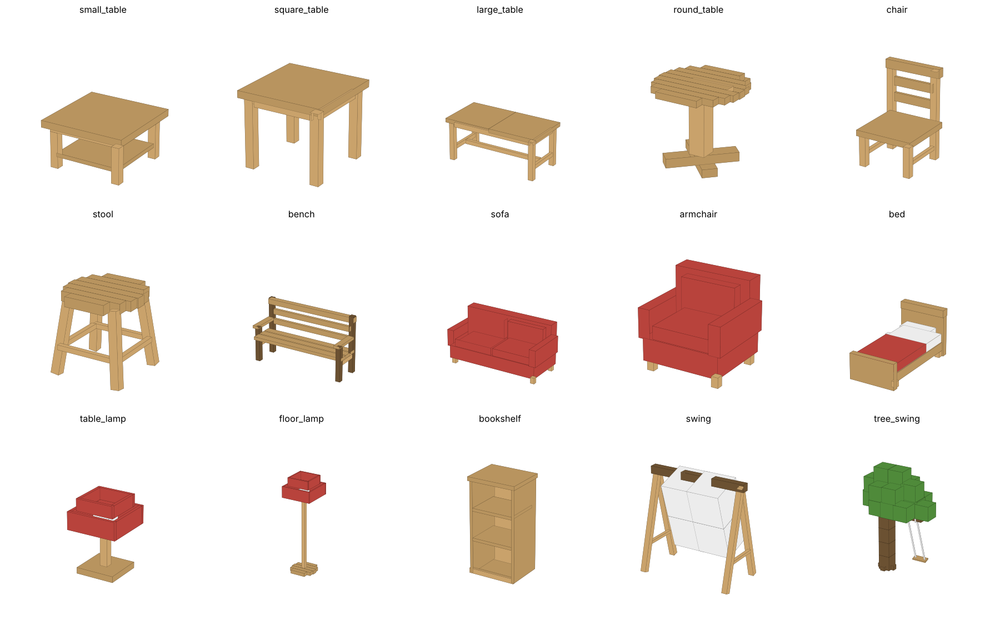

# CozyFurniture 溫馨傢俱

適用於 **Paper 26.3**（Java 25）的傢俱插件。
全部外觀都用原版的「方塊展示實體（Block Display）」組成，**不需要任何資源包**，玩家直接進服就看得到。

**下載：** [最新版 Releases](https://github.com/tengyao-pobo/CozyFurniture/releases/latest)



## 傢俱一覽

| ID | 名稱 | 尺寸 | 功能 |
|---|---|---|---|
| `small_table` | 小茶几 | 1×1 | 矮桌、附下層置物板，可在桌面擺放物品 |
| `square_table` | 方桌 | 1×1 | 標準高度四腳桌，可擺放物品 |
| `large_table` | 長桌 | 2×1 | 兩格長的大桌，可擺放物品 |
| `round_table` | 圓桌 | 1×1 | 木條拼成的圓形桌面＋單柱腳，可擺放物品 |
| `chair` | 椅子 | 1×1 | 有靠背的餐椅，右鍵坐下 |
| `stool` | 凳子 | 1×1 | 外八腳小圓凳，右鍵坐下（一次合成 2 個） |
| `bench` | 長椅 | 2×1 | 兩人座公園長椅，兩個座位 |
| `sofa` | 沙發 | 2×1 | 雙人布沙發，兩個座位 |
| `armchair` | 單人沙發 | 1×1 | 厚實的扶手沙發 |
| `bed` | 床 | 1×2 | 右鍵設定重生點；夜晚／雷雨可以睡覺跳過黑夜 |
| `table_lamp` | 檯燈 | 1×1 | **可以直接放在桌上**，右鍵開關，真的會發光 |
| `floor_lamp` | 落地燈 | 1×2 高 | 右鍵開關，真的會發光 |
| `bookshelf` | 書櫃 | 1×2 高 | 3 層、27 格，**放進去的書會一本本排在書架上** |
| `swing` | 鞦韆 | 3 寬×3 高 | A 字木架＋鐵鍊，會隨風自然搖晃 |
| `tree_swing` | 樹鞦韆 | 樹＋吊在樹枝上的鞦韆 | 一整棵小樹，繩子吊著木板鞦韆 |

每種傢俱都有 **11 種木材**：橡木、雲杉木、樺木、叢林木、相思木、黑橡木、紅樹林木、櫻花木、蒼白橡木、緋紅蕈木、扭曲蕈木。
木材會改變整件傢俱的材質，樹鞦韆的樹葉也會跟著變（櫻花木是粉紅櫻花樹、緋紅／扭曲是蕈類疣塊）。

沙發、床單、燈罩的**布料顏色**也依木材而定：

| 木材 | 布料 | 木材 | 布料 |
|---|---|---|---|
| 橡木 | 紅 | 紅樹林木 | 洋紅 |
| 雲杉木 | 綠 | 櫻花木 | 粉紅 |
| 樺木 | 淺灰 | 蒼白橡木 | 白 |
| 叢林木 | 淺綠 | 緋紅蕈木 | 紫 |
| 相思木 | 橘 | 扭曲蕈木 | 青 |
| 黑橡木 | 棕 | | |

## 玩法

- **放置**：手持傢俱，右鍵方塊。傢俱會面向你（每 90° 對齊）。放在地毯、半磚上會自動貼齊表面。
- **拆除**：左鍵傢俱。生存模式會掉落傢俱本身，以及書櫃裡的書、桌上的擺飾。
- **椅子／凳子／長椅**：右鍵坐下，Shift 起身。長椅會自動選離你點擊位置最近的空位。
- **桌子**：手持任何物品右鍵桌面 → 該物品會擺在你點的位置（方塊類直立、一般物品平放）。空手右鍵擺飾可以拿回來。
- **沙發**：右鍵坐下，和椅子一樣。
- **床**：右鍵會把重生點設在床上。夜晚或雷雨時右鍵就會躺上床，
  睡覺人數達到 `playersSleepingPercentage` 遊戲規則的比例後，5 秒後天亮並放晴。Shift 起床。
- **檯燈／落地燈**：右鍵開關燈。開燈時燈泡變成蕈光體、燈罩以全亮度顯示，並在燈的位置放置隱形光源方塊（亮度 15），
  所以周圍真的會被照亮。手持檯燈右鍵桌子即可把檯燈擺在桌上；拆掉桌子時桌上的檯燈也會一起掉落。
- **書櫃**：右鍵打開 27 格介面，只能放書（可在設定檔修改）。書本會依種類顯示不同顏色的書背：
  一般書隨機皮革色、附魔書紫色、書與羽毛筆白色、完成的書咖啡色；旁邊空著的書會稍微傾斜靠著。
- **鞦韆／樹鞦韆**：
  - 沒人坐時會隨風輕輕擺動（有陣風變化，下雨時晃得更大）。
  - 右鍵坐上去，**按住 W 越盪越高、按 S 煞車**，Shift 下來。
  - 擺動是依照單擺週期計算的（繩子越長擺得越慢），樹鞦韆的繩子比較長、風也比較大。

## 取得方式

1. **合成**（每種木材都有對應配方，配方書中可查看）：

| 傢俱 | 配方（P=木材、S=半磚、T=木棒、L=原木） |
|---|---|
| 小茶几 | `SSS` / `T T` |
| 方桌 | `PPP` / `T T` / `T T` |
| 長桌 | `SSS` / `PPP` / `T T` |
| 圓桌 | `SSS` / ` 去皮原木 ` / ` S ` |
| 椅子 | `P  ` / `PPP` / `T T` |
| 凳子 ×2 | `S` / `T` |
| 長椅 | `T  ` / `SSS` / `T T` |
| 書櫃 | `PSP` / `P書P` / `PSP` |
| 沙發 | `W W` / `WWW` / `S S`（W=該木材對應顏色的羊毛） |
| 單人沙發 | `W W` / `WSW` / `T T` |
| 床 | `W  ` / `WWW` / `PPP` |
| 檯燈 | `W` / `火把` / `S` |
| 落地燈 | `WWW` / ` 火把 ` / ` 去皮原木 ` |
| 鞦韆 | `LLL` / `鐵鍊 鐵鍊` / `鐵鍊 S 鐵鍊` |
| 樹鞦韆 | `樹葉×3` / `L 拴繩 L` / `L S L` |

2. **目錄介面**：`/furniture menu`（需要 `cozyfurniture.menu`，預設 OP）。
3. **指令**：`/furniture give <玩家> <種類> [木材] [數量]`

## 指令

| 指令 | 說明 | 權限 |
|---|---|---|
| `/furniture menu [木材]` | 開啟傢俱目錄 | `cozyfurniture.menu` |
| `/furniture give <玩家> <種類> [木材] [數量]` | 給予傢俱 | `cozyfurniture.admin` |
| `/furniture list` | 列出所有種類與木材 ID | 無 |
| `/furniture remove` | 移除準心對準的傢俱（不掉落） | `cozyfurniture.admin` |
| `/furniture reload` | 重新載入設定 | `cozyfurniture.admin` |

別名：`/fur`、`/cozyfurniture`

## 權限

| 權限 | 預設 | 說明 |
|---|---|---|
| `cozyfurniture.place` | 所有人 | 放置傢俱 |
| `cozyfurniture.break` | 所有人 | 拆除傢俱 |
| `cozyfurniture.use` | 所有人 | 坐下、開書櫃、在桌上擺放物品 |
| `cozyfurniture.menu` | OP | 開啟目錄並直接取得傢俱 |
| `cozyfurniture.admin` | OP | 管理指令 |

## 設定（config.yml）

```yaml
collision: true            # 桌子、書櫃、樹幹放置屏障方塊，產生實體碰撞
break-require-sneak: false # 需要蹲下 + 左鍵才能拆除
respect-protection: true   # 觸發方塊放置／破壞事件，相容領地保護插件
unlock-recipes: true       # 進服自動解鎖配方書
seat-height-offset: 0.0    # 坐姿高度微調
swing:
  idle-amplitude: 7.0      # 無人時隨風擺動幅度（度）
  rider-amplitude: 16.0    # 有人坐著時的基本幅度
  max-amplitude: 55.0      # 按住 W 最高可達的幅度
  storm-multiplier: 2.2    # 下雨時無人鞦韆的擺動倍率
table:
  max-decorations: 8       # 每張桌子最多擺幾個物品
bookshelf:
  allowed-items: [BOOK, WRITABLE_BOOK, WRITTEN_BOOK, ENCHANTED_BOOK, KNOWLEDGE_BOOK]
```

## 技術設計

- **外觀**：每件傢俱由多個 `BlockDisplay` 長方體組成（木板、去皮原木、原木、樹葉、鐵鍊、羊毛），
  透過 `Transformation` 縮放／旋轉，依放置方向整體旋轉。設計定義在 `model/Models.java`。
- **點擊判定**：`Interaction` 實體當作碰撞箱，負責右鍵使用與左鍵拆除。
- **碰撞**：桌子、書櫃、樹幹在佔用的格子放置屏障方塊；Interaction 稍微大於屏障，所以點擊一定會打到傢俱。
- **資料保存**：所有資料都存在實體的 PersistentDataContainer（傢俱 ID、種類、木材、方向、書櫃內容），
  跟著區塊一起存檔，不需要資料庫，也不會因為重啟遺失。
- **燈光**：燈具在佔用格放置原版 `LIGHT` 方塊作為真正的光源，關燈或拆除時移除。
- **睡覺**：插件自行計算睡覺人數並跳過黑夜（不需要原版床方塊），重生點以強制模式設定在床上。
- **坐下**：生成一個不存檔的隱形 `ItemDisplay` 讓玩家騎乘，伺服器關閉時自動清除。
- **鞦韆動畫**：擺角 = 振幅 × sin(相位)，相位依單擺角頻率 √(g/L) 前進；每 2 tick 更新一次變換，
  由客戶端的插值功能補成流暢動畫。沒有玩家在附近時只計算不送封包，座位實體會跟著擺動並帶著玩家一起盪。

## 建置

需要 JDK 25：

```bash
./gradlew build
# 產出 build/libs/CozyFurniture-1.0.0.jar
```

把 jar 放進伺服器的 `plugins/` 資料夾後重啟即可。

## 發佈新版本

修改 `build.gradle.kts` 中 `getOrElse("1.0.0")` 的版本號並推送到 `main`，
GitHub Actions 會自動編譯並建立對應的 `v版本號` Release（已發佈過的版本會自動略過）。
